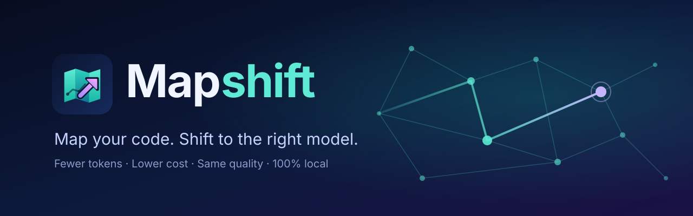

<p align="center">
  
</p>

<p align="center">
  <a href="LICENSE"></a>
  
  
  
</p>

**Mapshift** helps coding agents spend fewer tokens without doing worse work. It does two things:

- 🗺️ **Maps your code.** Every function, class and call in your project, kept fresh on its own. Your agent asks the map where things are instead of opening file after file.
- 🔀 **Shifts to the right model.** Each request gets the model and thinking effort it actually needs: a light model for a quick question, the strong one for risky or far-reaching changes.

It runs entirely on your computer. No account, no server, no telemetry. Your code never leaves your machine.

---

## Contents

- [Quick start](#quick-start)
- [What you get in each agent](#what-you-get-in-each-agent)
- [How the map works](#how-the-map-works)
- [How routing decides](#how-routing-decides)
- [How the numbers are counted](#how-the-numbers-are-counted)
- [Commands](#commands)
- [Turn it off or remove it](#turn-it-off-or-remove-it)
- [Privacy and safety](#privacy-and-safety)
- [FAQ](#faq)

---

## Quick start

You need [Node.js](https://nodejs.org) 22.13 or newer. Then run one line:

```bash
npx mapshift@latest setup
```

Setup finds the coding agents on your computer, shows exactly which files it will change, backs each one up, and asks before changing anything. Open a new chat in your agent and it is ready.

**Claude Code** gets the full experience (live model switching and a dashboard) as an add-on. In a terminal session:

```text
/plugin install mapshift --marketplace riverahendrick/mapshift
```

In the desktop app, click **+** next to the prompt box, then **Plugins**, **Add marketplace** with `riverahendrick/mapshift`, then **Add plugin**.

<details>
<summary><b>For AI agents:</b> install Mapshift for the person you work with</summary>

1. Check Node.js is 22.13 or newer: `node --version`.
2. Run `npx mapshift@latest setup --yes`. It installs a lasting copy and wires up every supported agent it finds.
3. If you are Claude Code, also run `claude plugin marketplace add riverahendrick/mapshift` and `claude plugin install mapshift@mapshift`.
4. Tell the person to open a new chat, and that `mapshift uninstall` removes everything again.

</details>

---

## What you get in each agent

| Agent | 🗺️ Map tools | 🔀 Model routing | 📊 Dashboard |
|---|---|---|---|
| **Claude Code** | ✅ | ✅ Automatic, every request | ✅ Panel beside the chat, plus a status band |
| **Codex** (CLI and IDE) | ✅ | 💡 Advice | `/prompts:mapshift` in the chat (with your 5-hour and weekly limits), and the web dashboard |
| **Gemini CLI** | ✅ | 💡 Advice | `/mapshift` in the chat, and the web dashboard |
| **Antigravity** (`agy`) | ✅ | 💡 Advice | ✅ Status line, `/mapshift`, and the web dashboard |
| **Grok CLI** | ✅ | 💡 Advice | ✅ Status line, `/mapshift`, and the web dashboard |
| **Cursor** (beta) | ✅ | 💡 Advice | Web dashboard |

Claude Code lets an add-on change the model on every request, so routing there is fully automatic. The other agents do not allow that today. There Mapshift advises instead: its instructions ask the agent to hand routine side work to lighter helpers where the agent has them, and `/mapshift` shows which model and effort the last request needed. If an agent adds a way to switch models, Mapshift will use it.

---

## How the map works

- **Builds itself.** The first time an agent uses a map tool in a project, the map builds in the background. There is nothing to run and nothing to remember.
- **Stays fresh.** Before every answer it checks which files changed (size and time, then content) and re-reads only those.
- **Understands 20 languages:**
  - Full call and import tracking: TypeScript, JavaScript, Python, Go, Java, Kotlin and C#, plus the scripts inside Vue and Svelte files.
  - Definitions and calls: Rust, PHP, Dart, Swift, Ruby, Scala, Lua, Elixir, PowerShell, C and C++.
- **Is honest about what it knows.** Every call link is marked: confirmed through an import, a fair guess, or ambiguous. Files it skips (very large, generated, unreadable) are listed by name, never silently missing.
- **Lives outside your project.** The map is kept in `~/.mapshift/`, so nothing is added to your repository, and all worktrees of a repository share one map.

Agents get five tools:

| Tool | What it answers |
|---|---|
| `map_find` | "Where is this done?", by plain words or by name, with the code, its callers and what it calls |
| `map_trace` | Who calls a function, what it calls, or everything a change to it can reach |
| `map_file` | A file's whole outline in a few lines |
| `map_overview` | The project at a glance: languages, main folders, entry points, most used code |
| `map_search` | Every line matching some text, grouped by the function it sits in |

---

## How routing decides

1. **The wording.** Is it a quick question, an everyday change, complex work, or risky work (security, money, data, production)? Pasted logs and code are set aside so they do not inflate the request.
2. **The map.** For a change, the map measures how far it spreads: how many functions and files call the code being changed. A change that reaches 60 functions across 13 files is harder than its wording suggests, so it moves up a level. A question stays a question, however widely used the code it asks about.
3. **Quality comes first:**
   - Mapshift never moves down on risky work or far-reaching changes.
   - It moves up after failing tests or repeated errors.
   - Your own choice always wins.

There are five modes: ⚡ **Auto** (the default), 💎 **Quality**, 🪙 **Saver**, 🎛️ **Manual** and ⏸️ **Off**. Each project remembers its own mode.

---

## How the numbers are counted

Every number Mapshift shows comes from its local logs, by these rules:

- **Map tokens saved:**
  - A map answer costs its own size.
  - It is credited with the full size of the files it pointed to, but only those the agent did **not** open anyway in that chat.
  - If the agent read them all, the answer saved nothing.
- **Without Mapshift** means the same requests run on the model you picked yourself, plus the files the map saved the agent from reading.
- **With Mapshift** is what was actually used.
- **Model switching** can cost more than it saves when hard work needs a stronger model. Mapshift shows that as it is ("$0.40 more, spent on stronger models for harder work").
- **Estimates:** sizes in tokens are estimated at four characters per token, and dollar values use each provider's list prices. Your plan may cost less, so these are labelled estimates. On a subscription, the limit gauges show what really matters.

`/mapshift trace` in Claude Code shows the inputs behind each decision.

---

## Commands

| Command | What it does |
|---|---|
| `mapshift setup` | Add Mapshift to your coding agents (`--dry-run` to preview, `--yes` to skip the question) |
| `mapshift report` | Map, savings and limits as text |
| `mapshift dash` | Open the dashboard in your browser |
| `mapshift off` / `on` | Pause Mapshift in every agent, or bring it back |
| `mapshift uninstall` | Take out everything setup added |
| `mapshift map build` | Build or update the map of this project |
| `mapshift map find <words>` | Find code by plain words or by name |
| `mapshift map trace <name>` | Who calls it (`--out`: what it calls, `--impact`: what a change reaches) |
| `mapshift route "<request>"` | Which model and effort a request needs |

In Claude Code, `/mapshift` opens the dashboard, and `/mapshift auto`, `quality`, `saver`, `manual` or `off` switch modes.

---

## Turn it off or remove it

```bash
mapshift off        # pause it everywhere
mapshift on         # bring it back
mapshift uninstall  # remove everything setup added, exactly
```

Setup backs up every file before changing it and only writes between its own clearly marked lines, so your own settings stay as they were.

---

## Privacy and safety

- **Fully local.** No telemetry, no update checks, no accounts. The map and its logs stay in `~/.mapshift/`.
- **Never touches credentials.** Mapshift never reads your login files and never routes your traffic through anything.
- **Safe with projects you do not trust.** Mapshift never starts a program from inside a project folder, it never follows links that point outside the project, and a project's own git settings cannot make it run anything.
- **Your settings only.** Setup changes personal settings only, never files shared with your team.

---

## FAQ

**Does it make my agent worse?**
Routing is built quality first: it only goes lighter where it is safe, never on risky or far-reaching work, and moves up after failures. In Claude Code you can always press **Think harder** or pick a mode.

**Does my code leave my computer?**
No. Mapshift reads your files locally and sends nothing anywhere.

**Which plans does it work with?**
Subscriptions and API keys alike. On a subscription the dashboard shows your 5-hour and weekly limits; with an API key it shows dollars.

**Windows, macOS, Linux?**
All three. It needs nothing but Node.js: no compilers, no native modules.

---

## License

[MIT](LICENSE). The bundled language grammars keep their own open-source licenses; see [THIRD_PARTY_NOTICES.md](THIRD_PARTY_NOTICES.md).
